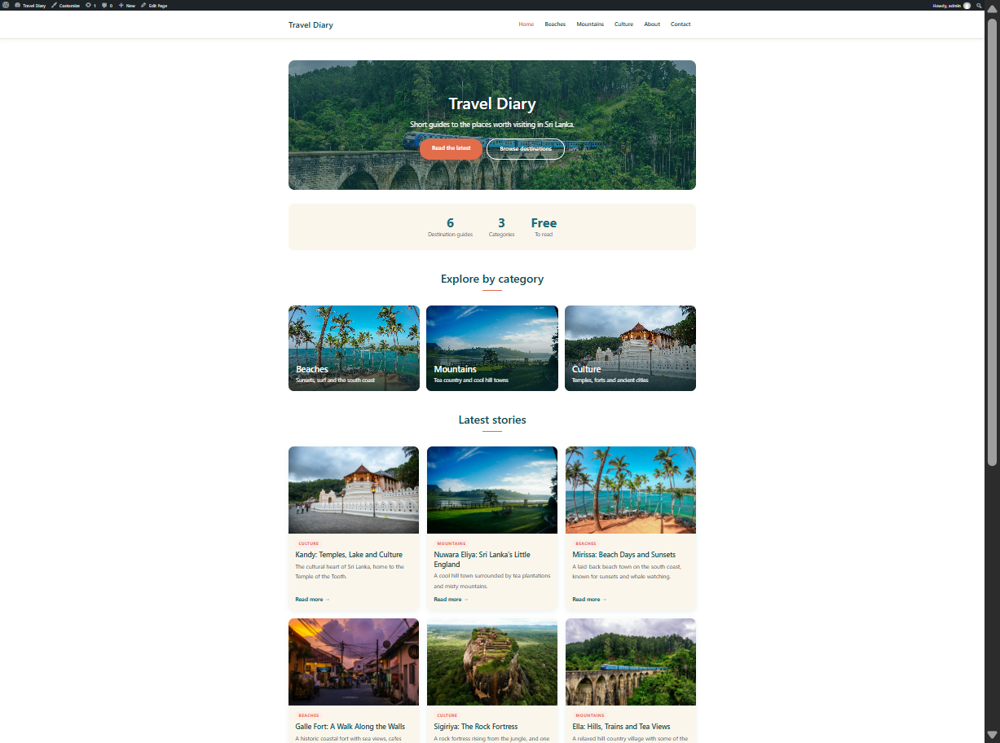
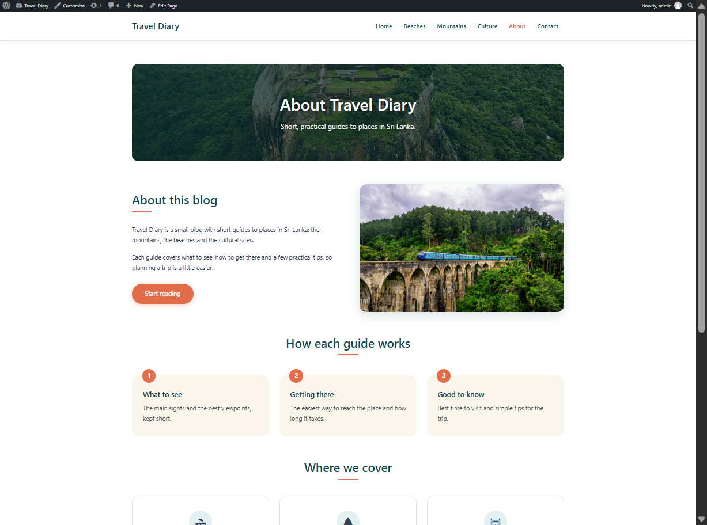
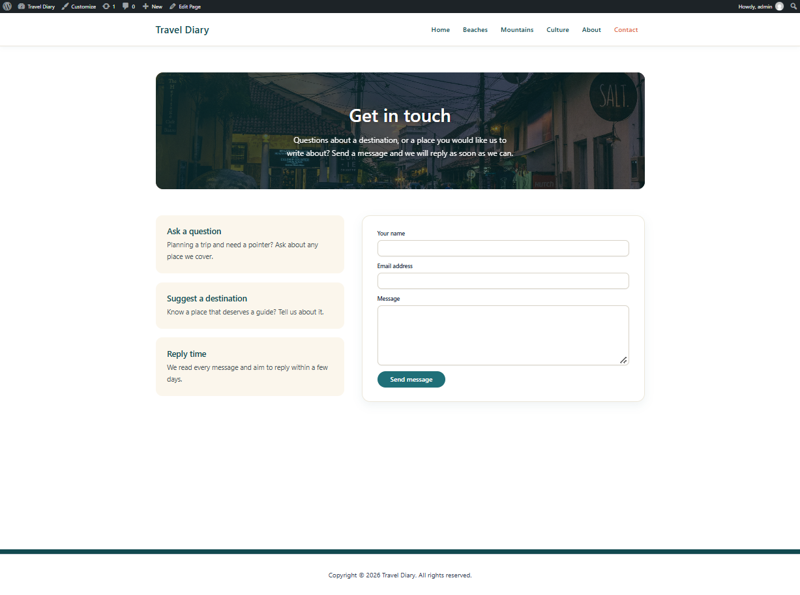
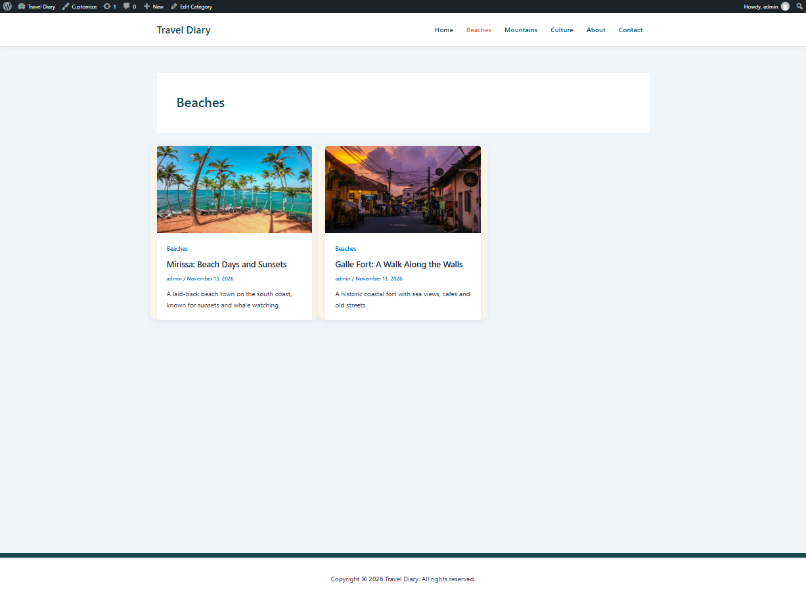
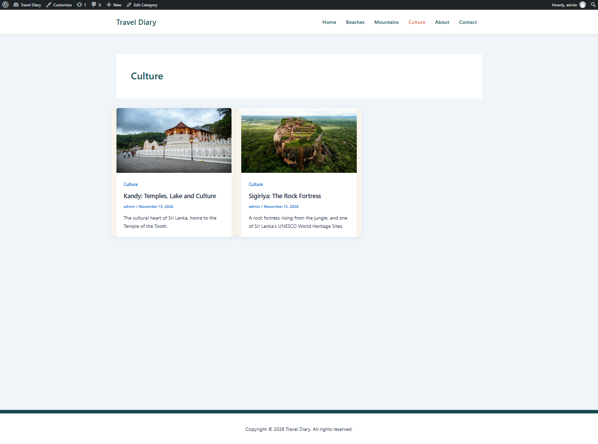
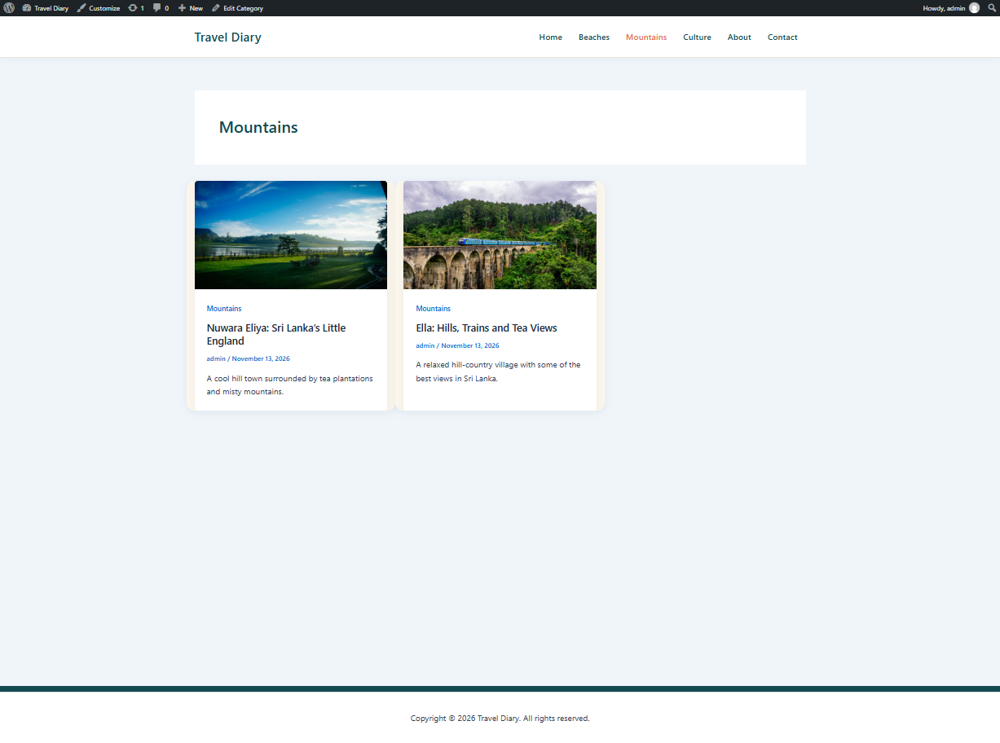
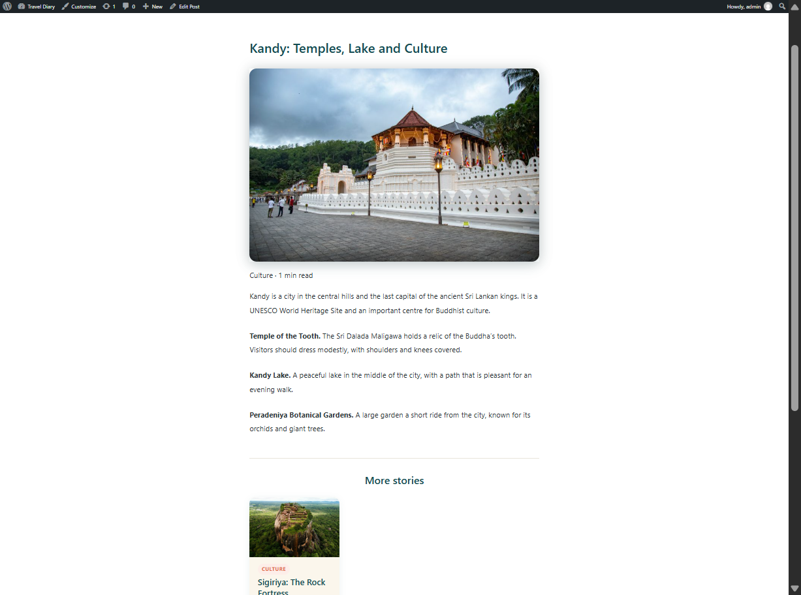
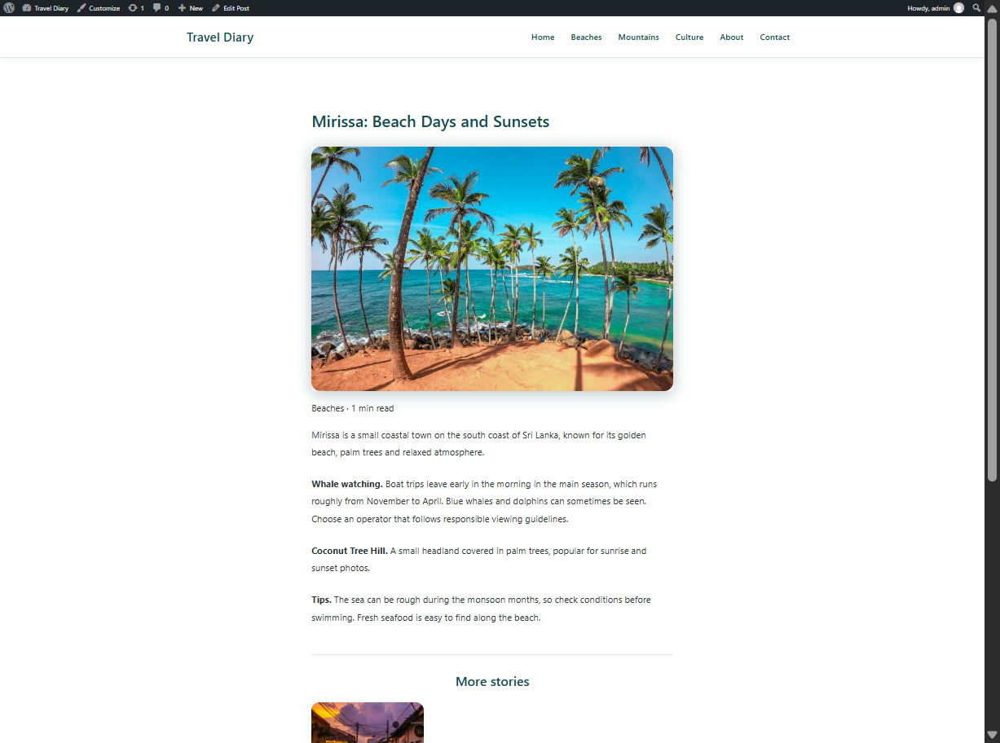
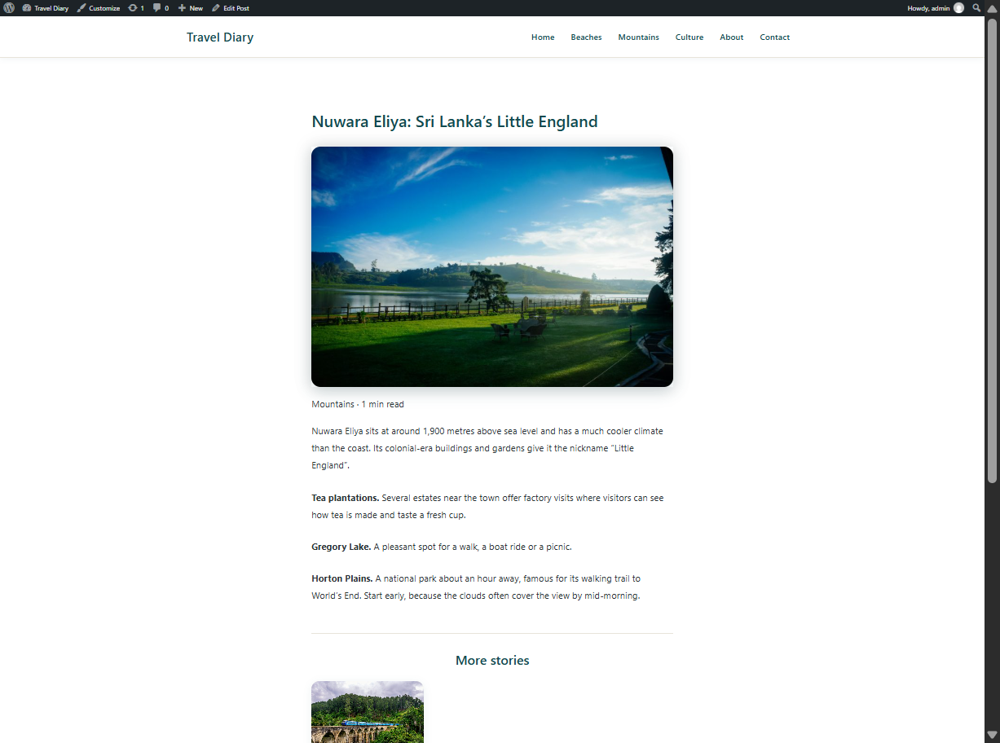

# Travel Diary – Sri Lanka Travel Blog

A WordPress-based travel blog showcasing destinations across Sri Lanka. The project features destination articles, category-based browsing, custom page layouts, and a custom contact form. It was developed locally using WAMP and the free Astra theme.

## Website Screenshots

### Home Page


### About Page


### Contact Page


### Destination Categories

| Beaches | Culture | Mountains |
|---|---|---|
|  |  |  |

### Destination Articles

| Kandy | Mirissa | Nuwara Eliya |
|---|---|---|
|  |  |  |

## Features

- Responsive travel-blog layout for desktop, tablet, and mobile screens
- Homepage with a hero section, destination category tiles, latest stories, and calls to action
- Six destination articles featuring Sri Lankan locations:
  - Ella
  - Sigiriya
  - Galle Fort
  - Mirissa
  - Nuwara Eliya
  - Kandy
- Three browsing categories: Beaches, Mountains, and Culture
- About and Contact pages
- Custom contact form with nonce verification, input sanitisation, and a hidden spam-trap field
- Submitted contact messages stored in the WordPress dashboard under **Messages**
- Email notification attempted through the WordPress `wp_mail()` function
- Latest-posts shortcode that displays automatically updated article cards
- Scroll-to-top control and clean footer styling

## Technologies Used

- **CMS:** WordPress
- **Theme:** Astra (free)
- **Backend:** PHP
- **Frontend:** HTML, CSS
- **Local development environment:** WAMP
- **Version control:** Git and GitHub

## Custom WordPress Plugin

The project includes a custom plugin located at:

`plugin/travel-diary-setup/`

The **Travel Diary Setup** plugin provides the site's initial content and custom functionality. On activation, it creates the main pages, destination posts, categories, featured images, navigation menu, homepage settings, and styling.

It also provides:

- `[td_contact]` – displays the contact form
- `[td_latest]` – displays the latest published posts as cards
- A **Messages** area in the WordPress dashboard for submitted enquiries

The plugin's CSS files are stored in `plugin/travel-diary-setup/css/`, and the destination images used by the plugin are stored in `plugin/travel-diary-setup/images/`.

## Repository Structure

```text
travel-diary-main/
├── assets/                         # Destination image assets
├── docs/
│   └── screenshots/                # Website screenshots for this README
├── plugin/
│   └── travel-diary-setup/
│       ├── css/                    # Custom website stylesheets
│       ├── images/                 # Destination images used by the plugin
│       └── travel-diary-setup.php  # Main custom plugin file
├── .gitattributes
├── .gitignore
└── README.md
```

## Run the Project Locally

This repository contains the custom project files, not a complete WordPress installation.

1. Install WAMP and set up a local WordPress site.
2. Create a database for the WordPress installation and complete the WordPress setup.
3. Install and activate the free **Astra** theme.
4. Copy the `plugin/travel-diary-setup/` folder into the WordPress `wp-content/plugins/` directory, or create a ZIP of that folder and upload it through **Plugins → Add New → Upload Plugin**.
5. Activate **Travel Diary Setup** from the WordPress Plugins page. The plugin creates the initial pages, posts, categories, menu, and homepage configuration.
6. Go to **Settings → Permalinks**, select **Post name**, and save the changes.
7. Open the local website and check the pages and destination posts.

> **Note:** The setup plugin is designed to create the initial site content when activated. Avoid repeatedly activating it on a site where you have already customised the generated content.

## Security and Repository Notes

- The repository is intended to hold the custom project files, not WordPress core files or a full local WordPress installation.
- Do not commit `wp-config.php`, database exports, passwords, private keys, local logs, or other sensitive configuration files.
- The `.gitignore` file excludes common local configuration, database, log, upload, and cache files.

## Learning Outcomes

Through this project, I practised:

- Building and styling a WordPress website
- Creating a custom WordPress plugin and using activation hooks
- Working with custom post types and shortcodes
- Managing posts, categories, featured images, and navigation menus
- Implementing and validating a contact form
- Applying responsive CSS
- Using Git and GitHub to manage and document a project

---

*Developed as a personal web development project.*
